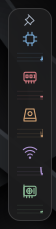
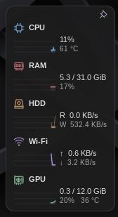

# Resource Sidebar

Monitor lateral para GNOME Shell 46: compacto o expandido, anclado independiente, hover sobre el escritorio visible y atajo **Shift + Alt izquierdo**.

## Vista previa

| Compacto | Expandido |
| --- | --- |
|  |  |

## Instalación rápida

Compatible y probado con **Zorin OS 18.1, GNOME Shell 46 y Wayland**. Otras distribuciones con GNOME 46 requieren comprobar dependencias y sensores. KDE, Xfce, Windows y macOS requieren portar la interfaz; no se instalan con este script.

```bash
git clone https://github.com/Maxdesigna7x/resource-sidebar.git
cd resource-sidebar
bash install.sh
```

Ejecuta sin sudo. Guarda tu trabajo, cierra sesión y vuelve a entrar. En una zona de escritorio expuesta del borde superior derecho, pasa el cursor; desde una aplicación, pulsa Shift + Alt izquierdo. Clic en el cuerpo cambia de tamaño y solo la chincheta cambia el anclado.

Para actualizar:

```bash
cd resource-sidebar
git pull --ff-only
bash install.sh
```

Vuelve a iniciar sesión tras actualizar código. Para quitarlo: `bash uninstall.sh`.

Creado y actualizado el 28 de octubre de 2026. Extensión propia de GNOME, inspirada en la referencia visual del usuario. El paquete contiene el código, instalador, desinstalador, pruebas y capturas. No depende de Mission Center ni de servicios web.

## Instalación actual

Equipo: Zorin OS 18.1, GNOME Shell 46, Wayland, NVIDIA RTX 3060 de 12 GiB, Intel UHD 730, unos 31 GiB de RAM disponibles para Linux. Disco raíz en `nvme1n1p2`, dispositivo físico `nvme1n1`. Wi-Fi detectada automáticamente; sensores CPU `coretemp`.

La extensión se instala en:

```text
~/.local/share/gnome-shell/extensions/resource-sidebar@randy.local/
```

**Después de instalar o actualizar, guarda el trabajo, cierra sesión y vuelve a entrar.** En Wayland esto permite que GNOME cargue el nuevo JavaScript. Activar y desactivar una versión ya importada no garantiza que se recargue el código. El instalador no cierra la sesión automáticamente.

## Uso de la versión 3.1

El tamaño y el anclado son preferencias **independientes**. Solo la chincheta cambia el anclado; pulsar el cuerpo del panel cambia el tamaño.

- **Oculto:** no hay pestaña, flecha ni icono. La zona de activación es una banda de 3 píxeles lógicos de ancho y 210 de alto junto al borde derecho, a partir del margen superior.
- **Hover:** coloca el cursor en un punto de esa banda donde se vea el escritorio, sin una ventana delante de ese punto. Tras unos 180–260 ms se abre el último tamaño seleccionado. **Puede haber ventanas en cualquier otra parte del monitor.** Una ventana que tape solo parte de la banda bloquea únicamente los puntos cubiertos.
- **Clic en el cuerpo:** cualquier parte del panel, salvo la chincheta, alterna entre compacto y grande. No fija ni suelta el panel y conserva el anclado actual.
- **Chincheta:** fija o suelta el tamaño actual. Se puede anclar tanto el compacto como el grande. Al cambiar de tamaño mientras está anclado, continúa anclado.
- **Salir con el cursor:** si no está anclado ni abierto mediante teclado, se oculta tras 650 ms. Esto también se aplica al grande: expandirlo no lo ancla.
- **Shift + Alt:** muestra u oculta el último tamaño seleccionado, desde el escritorio o cualquier aplicación, incluso a pantalla completa. Abierto mediante teclado permanece visible hasta volver a pulsar el atajo o modificar el anclado. El atajo **no cambia la preferencia de anclado**: si ocultas un panel anclado, la siguiente apertura sigue anclada.
- **Nueva sesión:** si estaba anclado, reaparece en el tamaño que habías elegido. Si no estaba anclado, arranca oculto y recuerda el tamaño para la próxima apertura.

La detección consulta la posición del cursor cada 80 ms y comprueba si una ventana visible del espacio de trabajo activo cubre exactamente ese punto, usando su rectángulo de marco. No se superpone un actor invisible que pueda interceptar clics sobre ventanas. Las ventanas minimizadas y de otros espacios no bloquean el hover. La vista de actividades y el bloqueo de sesión sí lo impiden.

El atajo usa Alt izquierdo y admite Shift izquierdo o derecho, en ambos órdenes de pulsación, sin tercera tecla. No utiliza AltGr. Shift + Espacio ya no está asignado al panel. El atajo funciona en el modo normal del escritorio. Se comprobó la configuración del equipo y no se encontró un cambio de idioma asignado a Shift + Alt; los atajos que incluyen Ctrl/Alt adicionales se conservan.

## Diseño y dimensiones medidas

Mediciones de los actores reales en GNOME 46, al 100 % de escala:

| Estado | Ancho × alto | Gráfica de cada métrica |
| --- | --- | --- |
| Oculto | Ningún elemento visible | — |
| Compacto | **44 × 213 px** | 26 × 13 px |
| Grande, anclado o sin anclar | **156 × 293 px** con las lecturas medidas | 60 × 24 px |

El grande tiene un ancho mínimo de 156 px y se ajusta a la anchura real del texto si una lectura o unidad necesita más espacio, evitando recortar datos. No reserva la columna vacía de las versiones anteriores. Los valores se alinean a la izquierda, a **6 px** de la gráfica. Se han quitado el título «RECURSOS», el pie «En vivo · historial de 60 s» y la pestaña con flecha. El fondo es gris neutro con opacidad del 94 %, borde tenue, sombra suave y acentos desaturados; no se aplica un efecto de refracción o blur.

Los tamaños se expresan en píxeles lógicos. Con escalado del escritorio o de texto las dimensiones físicas pueden variar. El panel parte del área útil del monitor principal, con margen superior de 18 px y derecho de 4 px, sin reservar espacio a las ventanas.

## Métricas

| Campo | Color | Valores | Gráfica |
| --- | --- | --- | --- |
| CPU | Azul `#76a9d4` | Uso global y temperatura | Uso 0–100 % |
| RAM | Rojo `#d0787f` | Usada / total y porcentaje | Uso 0–100 % |
| HDD | Naranja `#d1a071` | `R`: read (lectura); `W`: write (escritura) | Lectura fuerte, escritura tenue |
| Wi-Fi | Violeta `#aa90cd` | `↑`: subida; `↓`: bajada | Bajada fuerte, subida tenue |
| GPU | Verde `#88b894` | VRAM usada / total; procesamiento y temperatura | Procesamiento 0–100 % |

`HDD` es el nombre abreviado solicitado; en este equipo mide el NVMe del sistema. `Wi-Fi` mantiene ese texto como se pidió, aunque el lector sigue la interfaz de la ruta predeterminada: si se cambia a Ethernet o VPN, medirá esa interfaz.

Las velocidades están en **bytes por segundo**: KB/s = 1.000 B/s; MB/s = 1.000.000 B/s. RAM y VRAM están en **GiB** = 1.073.741.824 bytes. RAM usada = `MemTotal - MemAvailable`, para no contar toda la caché recuperable como ocupada.

La lectura se actualiza aproximadamente cada segundo. Se mantiene un historial de hasta 60 muestras en memoria, aunque ya no aparece un cartel indicándolo. El historial se llena desde el borde derecho; no se guarda en disco. La primera lectura de CPU/disco/red muestra `—` hasta tener dos muestras. Un sensor no disponible también muestra `—`.

El disco es el dispositivo físico que contiene `/`, incluida actividad de otras particiones del mismo dispositivo. Se resuelven particiones y capas LVM/device-mapper. Sistemas raíz especiales, ZFS o algunos Btrfs multidispositivo pueden necesitar adaptar la detección.

Se prioriza NVIDIA mediante `nvidia-smi`, con alternativa AMD por sysfs. Las métricas de GPU Intel no están implementadas. No se instalan ni cambian controladores desde este paquete.

## Reinstalar después de formatear

Puedes clonar este repositorio de nuevo o guardar toda esta carpeta en tu respaldo personal. Descomprime el paquete y, desde la carpeta que contiene `install.sh`, ejecuta:

```bash
bash install.sh
```

Ejecuta como usuario normal, **sin sudo**, y vuelve a iniciar sesión.

Dependencias: GNOME Shell 46, GJS, `/usr/bin/python3`, Python GObject (`python3-gi`), GLib/GSettings, `glib-compile-schemas` y `findmnt`. Para NVIDIA se requiere su controlador con `nvidia-smi`. Ya están disponibles en este Zorin.

El instalador comprueba GNOME 46, respalda una instalación previa en `~/.local/share/resource-sidebar/backups/`, copia los archivos y compila el esquema. Añade solo su UUID a la lista de extensiones habilitadas, conservando las demás. Respeta `XDG_DATA_HOME` si está definido. No usa systemd, autostart adicional ni permisos de administrador.

## Archivos y arquitectura

```text
resource-sidebar/
├── README.md
├── VALIDACION.md
├── install.sh
├── uninstall.sh
├── capturas/
├── tests/test_collector.py
└── resource-sidebar@randy.local/
    ├── metadata.json
    ├── extension.js
    ├── stylesheet.css
    ├── collector.py
    ├── icons/*.svg
    └── schemas/
```

La interfaz usa GJS, St, Clutter y Cairo. El único actor añadido al escritorio es la tarjeta. La zona de hover se detecta consultando el cursor y los rectángulos de las ventanas, sin crear otro actor. `Main.wm.addKeybinding` registra el atajo configurado en GSettings. Al deshabilitar se elimina el atajo, se desconectan señales y se liberan actores y temporizadores.

Un único proceso Python hijo lee `/proc/stat`, `/proc/meminfo`, `/proc/diskstats`, rutas de red, `/sys/class/net` y `/sys/class/hwmon`. Detecta el disco con `findmnt`/sysfs y consulta NVIDIA una vez por muestra, con tiempo límite. Emite JSON por líneas que GJS consume de forma asíncrona. No envía datos a Internet ni guarda registros de actividad. Al desactivar se termina el lector; si falla mientras está activo, los valores pasan a «Sin datos» y se reintenta con espera creciente hasta 30 s.

## Personalizar

Edita la copia fuente, ejecuta `bash install.sh` y vuelve a iniciar sesión.

- `extension.js`: `EXPANDED_MIN_WIDTH=156`, `COMPACT_WIDTH=44`, `EDGE_HEIGHT=210`; gráficas de 60 × 24 / 26 × 13; margen de 18/4; activación de 180 ms y ocultación de 650 ms. `METRICS` define etiquetas y colores. Los colores SVG correspondientes están en `icons/`.
- `stylesheet.css`: fondo gris, tipografía, espaciado y bordes. Las filas y la altura se calculan a partir de los tamaños reales del texto y las gráficas; el alto no se fuerza a un valor fijo que pudiera recortar contenido.
- `collector.py`: fuentes de métricas, selección de disco/GPU e intervalo.
- `schemas/`: preferencias independientes `pinned` (anclado) y `expanded` (tamaño), y atajo `toggle-sidebar`.

Cambiar el atajo una vez instalado:

```bash
GSETTINGS_SCHEMA_DIR="$HOME/.local/share/gnome-shell/extensions/resource-sidebar@randy.local/schemas" \
  gsettings set org.gnome.shell.extensions.resource-sidebar toggle-sidebar "['<Shift>Alt_L', '<Alt>Shift_L', '<Alt>Shift_R']"
```

Para usar otro atajo cambia ese último valor. Para deshabilitarlo, usa `"[]"`. Si se ha personalizado `XDG_DATA_HOME`, ajusta la ruta del esquema. La preferencia `pinned` acepta `true` o `false` con el mismo comando.

## Desactivar, quitar y diagnosticar

```bash
gnome-extensions disable resource-sidebar@randy.local
gnome-extensions enable resource-sidebar@randy.local
bash uninstall.sh
```

La desinstalación conserva el paquete original, respaldos y preferencias. No modifica las otras extensiones.

```bash
gnome-extensions info resource-sidebar@randy.local
journalctl --user -b -o cat | rg 'resource-sidebar|Resource Sidebar'
/usr/bin/python3 resource-sidebar@randy.local/collector.py --samples 3
/usr/bin/python3 -m unittest discover -s tests -v
nvidia-smi --query-gpu=name,utilization.gpu,memory.used,memory.total,temperature.gpu --format=csv
```

Si no aparece tras instalar, vuelve a iniciar sesión y comprueba que las extensiones de usuario estén permitidas. **Si una ventana cubre el punto del borde donde está el cursor, el hover no abre el panel: usa un punto libre de la banda o Shift + Alt.** En una instalación nueva o actualizada, antes de volver a entrar puede aparecer la versión antigua o no encontrarse todavía la extensión.

Si falta una métrica, ejecuta el lector con `--samples 3`, comprueba NVIDIA con `nvidia-smi` y los sensores CPU con hwmon. No es necesario ejecutar la extensión como root.

## Portar a otro sistema

- **Otra distribución con GNOME 46:** reutiliza el paquete, comprueba las dependencias y valida sensores y atajos en ese sistema.
- **GNOME de otra versión:** revisa y prueba las API de St, Clutter, Meta, Cairo, `Main.wm` y `Main.layoutManager`. Solo después actualiza `shell-version` en `metadata.json` y la comprobación de `install.sh`. Cambiar únicamente el número no garantiza compatibilidad.
- **KDE Plasma, Xfce, Cinnamon o Zorin Lite:** reutiliza el lector Linux y el protocolo JSON; porta la interfaz, el hover del borde y el atajo al compositor/escritorio correspondiente.
- **Windows/macOS:** conserva el diseño y el protocolo JSON como referencia, con una interfaz y un lector de métricas propios del sistema.

Referencias:

- [Extensiones GNOME con GJS](https://gjs.guide/extensions/development/creating.html)
- [Componentes St](https://gjs.guide/extensions/topics/st-widgets.html)
- [Sensores hwmon de Linux](https://github.com/torvalds/linux/blob/master/Documentation/hwmon/sysfs-interface.rst)
- [Telemetría AMD](https://www.kernel.org/doc/html/v6.6/gpu/amdgpu/thermal.html)
